# Territory Predictive Insights - CitizenTech

**Global Solution 2026.2 - Programação Orientada a Objetos - FIAP**

Sistema em Java que monitora um território sujeito a alagamentos, simula leituras de sensores, faz previsões simples para a próxima hora e emite alertas explicados para a comunidade.

## Integrantes

| Nome | RM |
|---|---|
| Nícolas Borges Natal | 568230 |
| Pedro Ricardo de Almeida | 567056 |
| Sofia Fernandes de Lima Oliveira | 567824 |

---

## Público beneficiado

**Quem sofre o problema:** moradores de bairros de várzea que alagam com frequência, como o **Jardim Pantanal**, na Zona Leste de São Paulo, às margens do Rio Tietê e de córregos que transbordam em dias de chuva forte. Quando a água sobe, essas famílias perdem móveis, documentos e remédios, e às vezes precisam sair de casa às pressas.

**Qual decisão o sistema apoia:** *"devo me preparar ou sair de casa agora?"*. O sistema acompanha a chuva, o nível do córrego e a umidade do solo e, quando a previsão se aproxima dos limites definidos pela Defesa Civil, mostra no painel da praça **o nível de risco e o que fazer** (acompanhar os avisos, afastar-se do córrego ou procurar um local seguro).

Quem configura os limites é a **Defesa Civil / associação de moradores**, por meio de um código de acesso.

> Todos os dados são simulados. O território é descrito só por região e equipamento, nunca por pessoas.

---

## Recorte escolhido: Clima (alagamentos)

| Sensor | O que mede | Unidade | Limite padrão |
|---|---|---|---|
| `SensorChuva` | Intensidade da chuva | mm/h | 30 mm/h |
| `SensorNivelRio` | Nível do córrego | m | 3,5 m |
| `SensorUmidade` | Umidade do solo (solo encharcado não absorve mais chuva) | % | 85 % |

---

## Como rodar

**Requisito:** JDK 17 ou superior (o projeto foi desenvolvido com JavaSE-21).

### Pelo Eclipse

1. **File > Import > General > Existing Projects into Workspace** e selecione a pasta do repositório.
2. Recomendado: **Window > Preferences > General > Workspace > Text file encoding = UTF-8**, para os acentos aparecerem certos no console.
3. Abra `src/br/com/citizentech/main/SistemaMonitoramento.java` e clique em **Run** (Ctrl + F11).
4. Clique dentro da aba **Console** antes de digitar as opções do menu.

### Pelo terminal (na raiz do repositório)

```bash
javac -encoding UTF-8 -d bin src/br/com/citizentech/model/*.java src/br/com/citizentech/main/*.java
java -cp bin br.com.citizentech.main.SistemaMonitoramento
```

Se os acentos aparecerem trocados por `?` no terminal, rode com `java -Dstdout.encoding=UTF-8 -cp bin br.com.citizentech.main.SistemaMonitoramento` (no Windows, use também `chcp 65001` antes).

### Código de acesso inicial

O código para alterar os limiares é **`defesa2026`** (pode ser trocado pelo próprio menu, opção 4 → 7).

---

## Como usar o menu

```
1. Verificar sensores             -> status de cada equipamento, leituras atuais x limites + ligar/desligar
2. Simular próximas leituras      -> N horas de leituras (1 a 48)
3. Rodar previsões e alertas      -> 2 estratégias x 3 sensores, com explicação de cada previsão
4. Gerenciar dados do território  -> região, população, limiares (com código), troca de código
5. Exibir status completo         -> território, equipamentos, estratégias e último alerta
6. Simular 24 horas com alertas   -> bônus
0. Sair
```

**Roteiro rápido de teste:**

1. `3` → sem leituras, o sistema **se cala**.
2. `2` e `12` → 12 horas de leituras (`---` = falha simulada do sensor).
3. `3` → previsões e, se houver risco, alertas no painel.
4. `4`, `4`, código `errado`, limite `10` → acesso negado (o menu pede o limite antes de conferir o código). Repita com `4`, código `defesa2026` e limite `10` → limite alterado. Digite `0` para voltar ao menu principal.
5. `1`, `2` → desliga o pluviômetro (digite `0` se aparecer o pedido de equipamento de novo). Depois `3` → o sensor desligado não é avaliado, e na opção `1` ele aparece como "sem leitura confiável".
6. `6` → simulação de um dia inteiro com resumo no final. Se quiser que o pluviômetro participe, religue-o antes (`1`, `2`).

---

## Estrutura do projeto

```
Global_Solution-Nicolas_Pedro_Sofia-OOP-2026.2/
├── src/br/com/citizentech/
│   ├── model/
│   │   ├── ComponenteTerritorial.java   (classe abstrata)
│   │   ├── PainelInformativo.java       (concreta, herda de ComponenteTerritorial)
│   │   ├── Sensor.java                  (interface)
│   │   ├── SensorChuva.java             (herda de ComponenteTerritorial e implementa Sensor)
│   │   ├── SensorNivelRio.java          (herda de ComponenteTerritorial e implementa Sensor)
│   │   ├── SensorUmidade.java           (herda de ComponenteTerritorial e implementa Sensor)
│   │   ├── HistoricoLeituras.java       (ArrayList com as últimas leituras de um sensor)
│   │   ├── DadosTerritorio.java         (encapsulamento + código de acesso)
│   │   ├── EstrategiaPrevisao.java      (classe abstrata)
│   │   ├── PrevisaoMediaMovel.java      (herda de EstrategiaPrevisao)
│   │   ├── PrevisaoComparacao.java      (herda de EstrategiaPrevisao)
│   │   ├── Alerta.java                  (nível, sensor de origem e explicação)
│   │   └── CentralAlertas.java          (compara previsão x limiar e publica no painel o alerta mais grave)
│   └── main/
│       └── SistemaMonitoramento.java    (classe principal com menu)
├── diagramas/                           (diagramas UML exportados do Astah, um por commit)
│   ├── diagrama-commit_1.png ... diagrama-commit_6.png
│   ├── diagrama-sistema-commit_7.png
│   ├── diagrama-modelo-commit_8.png
│   ├── diagrama-sistema-commit_8.png
│   ├── diagrama-modelo-commit_9.png
│   └── diagrama-sistema-commit_9.png
├── .project, .classpath, .settings/     (configuração do projeto no Eclipse)
├── .gitignore
└── README.md
```

Usamos os pacotes `model` (o que o sistema **é**) e `main` (como o usuário **conversa** com ele), como fizemos nas aulas.

---

## Conceitos de POO aplicados

### 1. Classe abstrata - `ComponenteTerritorial`

- Tem os atributos comuns a todo equipamento do território: `id`, `nome`, `regiao`, `status`.
- Tem métodos concretos comuns: `ativar()`, `desativar()`, `realocar()`, `getResumo()`.
- Tem o método **abstrato** `verificarStatus()`: cada equipamento explica do seu jeito como está funcionando.
- `new ComponenteTerritorial(...)` não compila, porque não existe "equipamento genérico" no mundo real.
- Classes concretas que herdam dela: `PainelInformativo`, `SensorChuva`, `SensorNivelRio`, `SensorUmidade`.

### 2. Interface - `Sensor`

- Contrato que todo sensor cumpre: `lerValor()`, `verificarFuncionamento()`, `getTipo()`, `getUnidade()`, `ultrapassouLimite()`, `getHistorico()` e `getNome()`.
- Implementada por **3 classes**: `SensorChuva`, `SensorNivelRio`, `SensorUmidade`.
- Cada sensor **herda** de `ComponenteTerritorial` **e implementa** `Sensor` (`extends ... implements ...`), como o `CarroEletrico` da Aula 9.
- O `getNome()` da interface já é cumprido pelo método herdado da classe mãe: implementado uma vez, vale para os dois.
- Cada sensor simula valores de um jeito diferente, em faixas realistas:
  - **Chuva:** 60% das horas com chuva fraca, 30% moderada e 10% temporal.
  - **Rio e umidade:** variam aos poucos a partir da leitura anterior, sem saltos. Cada um alterna entre um período de cheia (ou de chuva), em que sobe, e um período normal, em que volta aos poucos ao nível de base.
- Cada sensor tem **5% de chance de falha** por leitura. A leitura com falha não entra no histórico.

### 3. Encapsulamento - `DadosTerritorio`

- **Todos** os atributos são `private`: região, população, código de acesso e os 3 limiares.
- `setPopulacao()` rejeita valores ≤ 0 e `setNomeRegiao()` rejeita texto vazio. Nos dois casos o valor anterior é **mantido**.
- Os limiares só mudam com o **código de acesso** correto **e** dentro de uma faixa válida (ex.: chuva entre 5 e 100 mm/h).
- O código **não tem getter**: ninguém consegue lê-lo, só conferi-lo. No resumo ele aparece como `****`.
- `HistoricoLeituras.getLeituras()` devolve uma **cópia** da lista, então quem recebe não consegue apagar o histórico original.

### 4. Herança - `EstrategiaPrevisao`

- Classe abstrata com o que é comum a toda previsão: `nome`, `leiturasMinimas`, `podePrever()`, `getMotivoSemPrevisao()` e o método `protected calcularMedia()`, reaproveitado pelas filhas.
- Dois métodos **abstratos**: `prever()`, que faz a conta, e `explicar()`, que diz em texto o que a previsão significa.
- **`PrevisaoMediaMovel`** (atributo próprio: `tamanhoJanela`): média das últimas 5 leituras. O `explicar()` mostra as leituras usadas na média.
- **`PrevisaoComparacao`** (atributo próprio: `tamanhoPeriodo`): compara a média das últimas 3 leituras com a das 3 anteriores e projeta a mesma variação. O `explicar()` mostra a tendência (SUBINDO, DESCENDO ou ESTÁVEL).
- As duas usam `super(...)` no construtor e `super.getDescricao()` dentro do próprio `getDescricao()`.
- Cada uma sobrescreve `prever()` e `explicar()` com `@Override`.

### 5. Polimorfismo e associação

- O menu trabalha com `List<Sensor>` e `List<EstrategiaPrevisao>`, e o mesmo `for` funciona para qualquer sensor ou estratégia, sem `if` para descobrir o tipo.
- O mesmo objeto sensor está em duas listas: como `Sensor` (para ler e prever) e como `ComponenteTerritorial` (para ligar, desligar e mostrar status), sem nenhum *cast*.
- Associações:
  - `CentralAlertas` **tem um** `DadosTerritorio` e **um** `PainelInformativo`, e uma lista de `Alerta`.
  - Cada `Alerta` **tem um** `Sensor` de origem.
  - Cada sensor **tem um** `HistoricoLeituras`.

---

## Previsões e alertas

A cada rodada, cada sensor é avaliado pelas **2 estratégias**, e a previsão é comparada com o limite configurado no território. Se mais de um sensor gerar alerta na mesma rodada, o painel mostra **o mais grave**. Se nenhum gerar, o painel volta para "Sem alertas no momento".

| Previsão em relação ao limite | Nível | O que o painel recomenda |
|---|---|---|
| menos de 80% | sem alerta | - |
| 80% a 99% | **ATENÇÃO** | Acompanhar os avisos do painel |
| 100% a 129% | **ALERTA** | Evitar as margens do córrego e as áreas baixas; separar documentos e remédios |
| 130% ou mais | **CRÍTICO** | Procurar um local seguro e seguir a Defesa Civil (199) |

Cada alerta explica o **porquê**: qual sensor, o valor previsto por cada estratégia, a porcentagem do limite e o nível de confiança. Exemplo real de uma execução:

```
[ALERTA] Régua do Córrego Três Pontes (NIVEL_RIO)
- Média Móvel prevê 3.14 m = 89.7% do limite de 3.5 m -> ATENÇÃO
- Comparação de Períodos prevê 4.15 m = 118.6% do limite de 3.5 m -> ALERTA
Confiança menor: as estratégias discordam. Foi usado o nível mais grave por precaução.
O que fazer: Evite as margens do córrego e as áreas baixas. Prepare documentos e remédios.
```

---

## Decisões da equipe

- **Recorte de clima:** escolhemos alagamentos porque os 3 sensores se complementam: a chuva é a causa, o rio é a consequência e o solo encharcado agrava o risco.
- **Sensores como `ComponenteTerritorial` + `Sensor`:** os sensores são equipamentos instalados no território (têm id, região e podem ser ligados ou desligados) e também cumprem o contrato de leitura. Por isso herdam da classe abstrata e implementam a interface.
- **`HistoricoLeituras` em classe própria:** os 3 sensores precisam guardar leituras. Com uma classe separada, a lógica do `ArrayList` (adicionar, descartar a mais antiga e devolver cópia) foi escrita uma vez só.
- **Duas estratégias, no máximo um alerta por sensor:** quando as estratégias discordam, o sistema usa o nível mais grave **por precaução** e avisa que a confiança é menor.
- **Sensor com falha não gera alerta:** dado ruim não vira alarme. Na verificação de sensores, um sensor desligado ou com falha aparece como "sem leitura confiável", e não com a última leitura antiga.
- **Risco agora x risco previsto:** a opção 1 compara a **leitura atual** de cada sensor com o limite (`ultrapassouLimite()`), enquanto a opção 3 compara a **previsão**. Assim, um pico que a média esconde ainda aparece para quem está acompanhando.
- **Painel mostra só o alerta mais grave:** o painel da praça tem espaço para uma mensagem, então, quando vários sensores alertam na mesma hora, aparece a mais urgente.
- **Painel desligado não exibe mensagens**, e isso aparece no status, para a Defesa Civil saber que a comunidade não está sendo avisada.
- **Limite de 3 parâmetros por método** (Clean Code, Aula 4): por isso o `Alerta` recebe o valor e o limite dentro do texto da explicação, e não como parâmetros separados.
- **Setters privados ou ausentes** quando o dado não deve mudar livremente. Por exemplo, a região de um equipamento só muda com `realocar()`, e o código de acesso não tem getter.

---

## Bônus: simulação de 24 horas

Escolhemos **um** bônus: a simulação de 24 horas. A opção **6** roda 24 horas seguidas como o sistema funcionaria sozinho: a cada hora, lê os 3 sensores, avalia as previsões e publica os alertas no painel. No final mostra um resumo:
- total de alertas e de críticos;
- a hora do primeiro alerta;
- quantas horas tiveram pelo menos um alerta;
- o pico de cada sensor comparado com o limite.

Durante a simulação a `CentralAlertas` fica em **modo silencioso**: só o painel "fala", para o console não ficar com centenas de linhas.

---

## Diagramas UML (Astah)

Versão final (commit 9):

**Modelo completo (pacote `model`):**

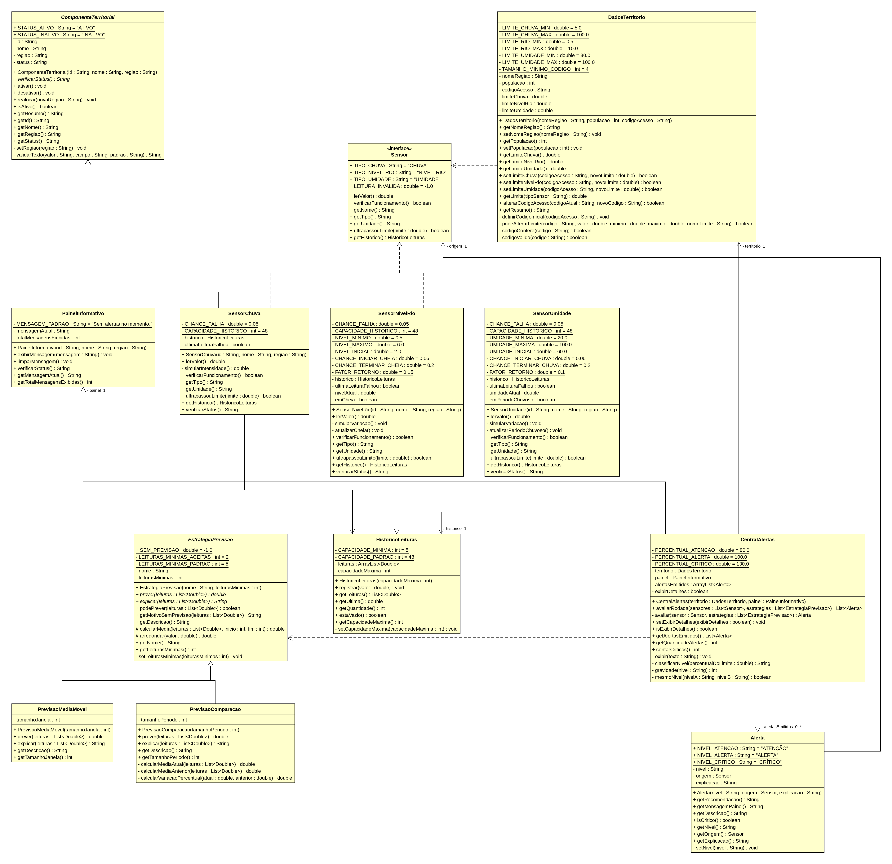

**Classe principal e suas associações:**

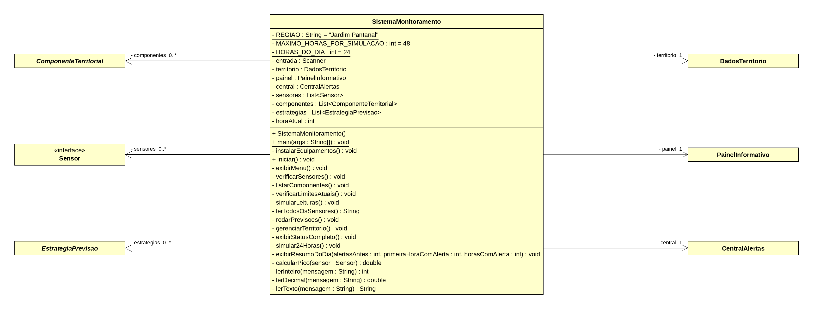

<details>
<summary>Evolução dos diagramas, commit por commit</summary>

**Commit 1 - Classe abstrata `ComponenteTerritorial` e `PainelInformativo`**
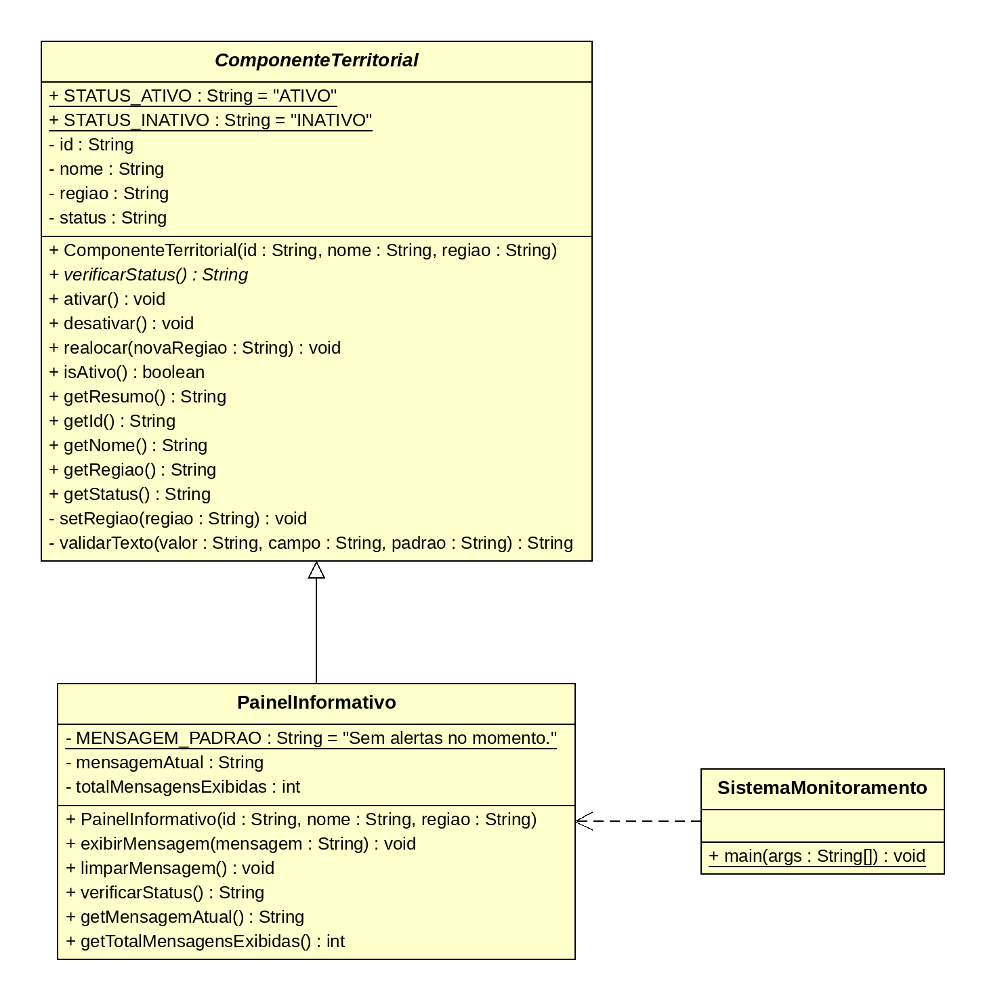

**Commit 2 - Interface `Sensor`, `SensorChuva` e `HistoricoLeituras`**
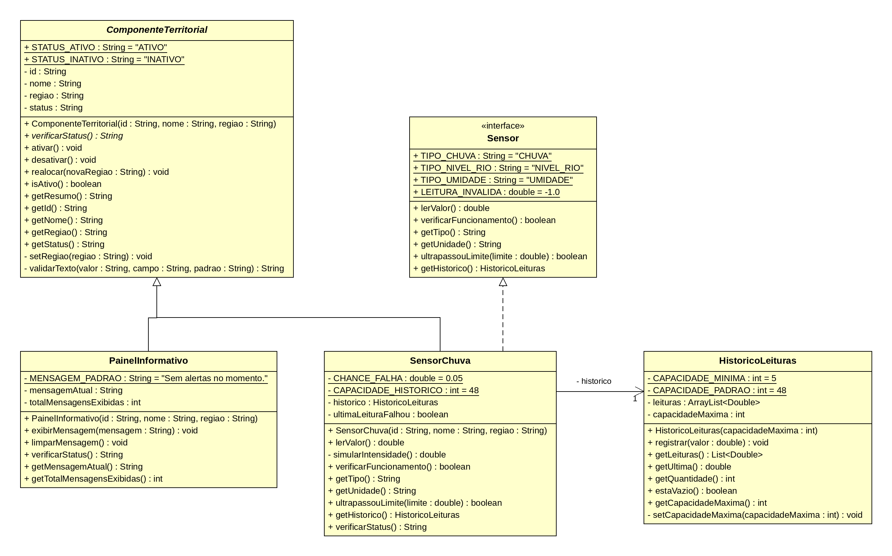

**Commit 3 - Encapsulamento: `DadosTerritorio`**
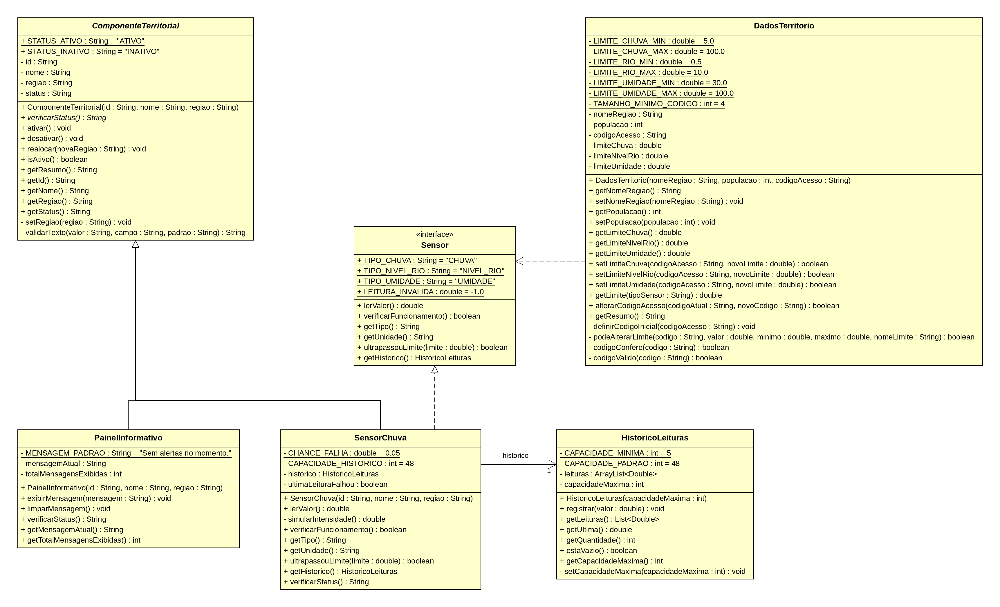

**Commit 4 - Herança: `EstrategiaPrevisao` e `PrevisaoMediaMovel`**
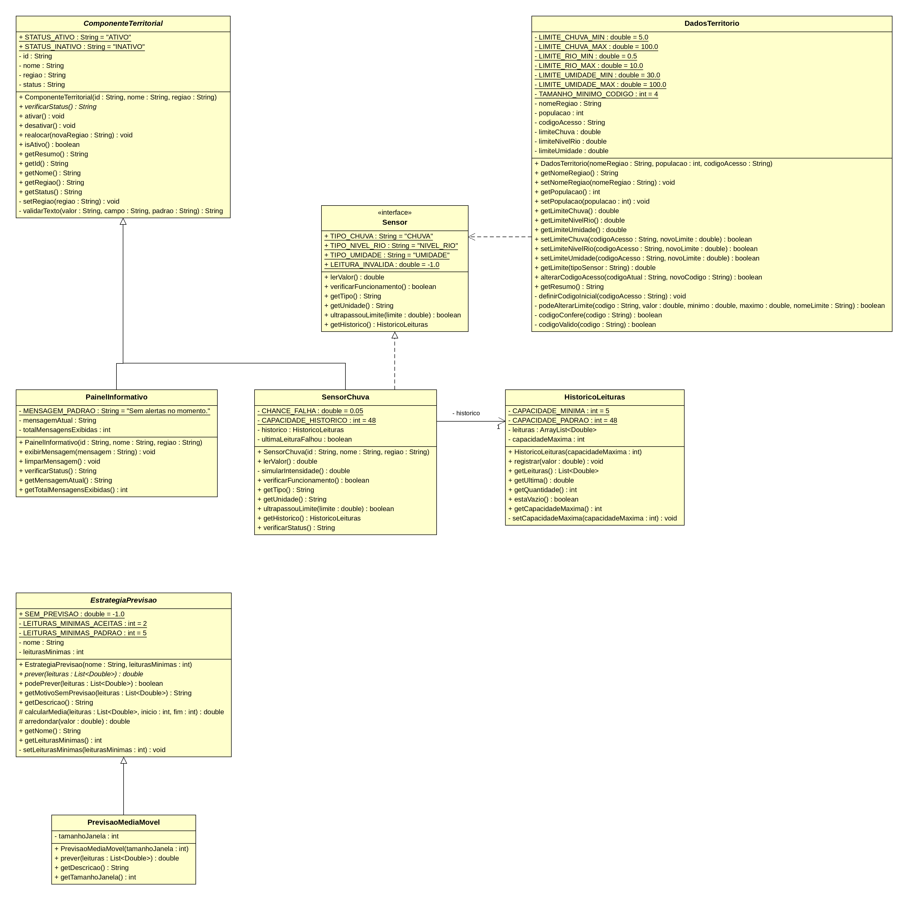

**Commit 5 - `SensorNivelRio`, `SensorUmidade` e `PrevisaoComparacao`**
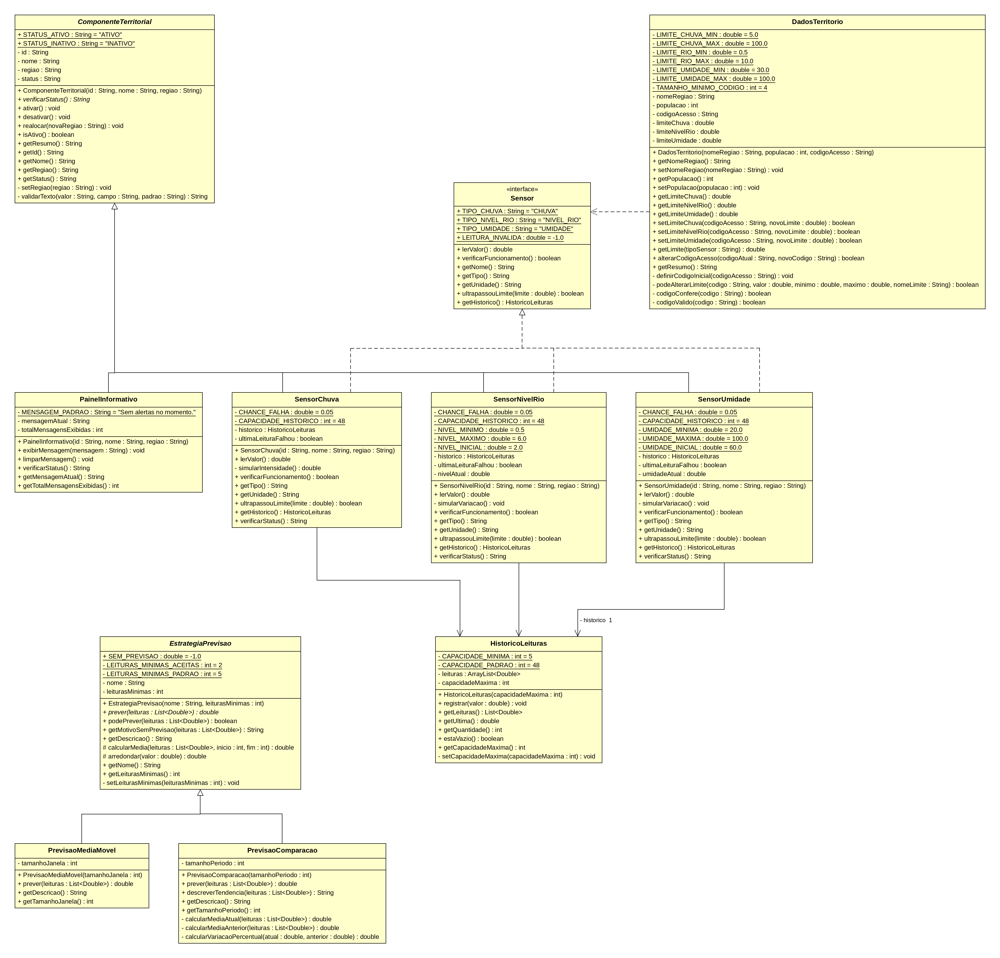

**Commit 6 - `Alerta` e `CentralAlertas`**
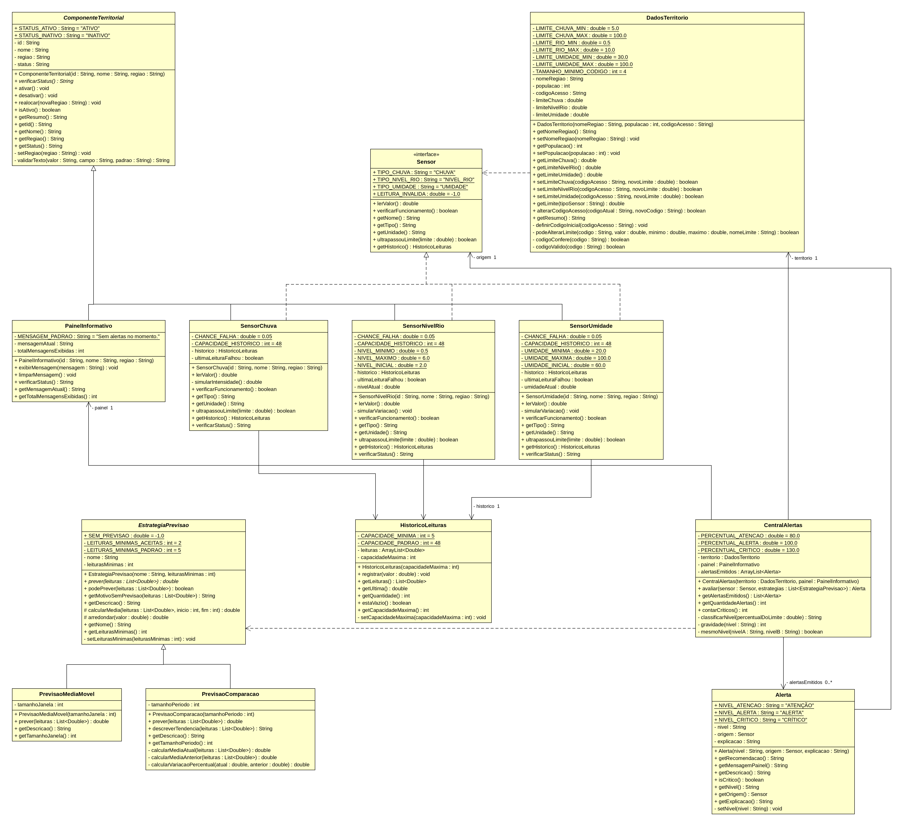

**Commit 7 - Menu principal (`SistemaMonitoramento`)**
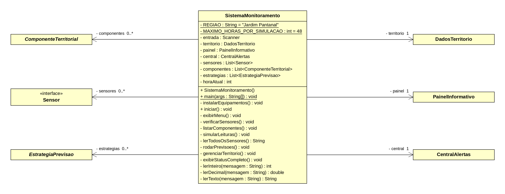

**Commit 8 - Bônus: simulação de 24 horas**

Modelo:
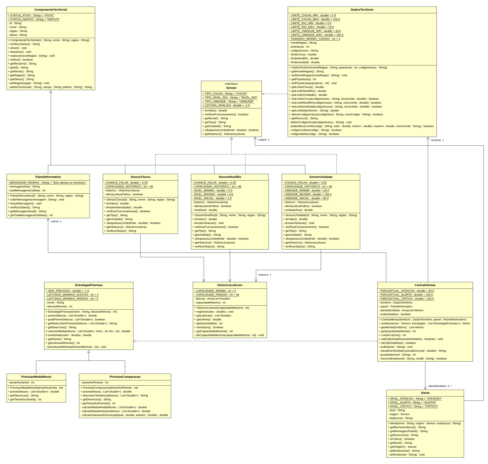

Sistema:
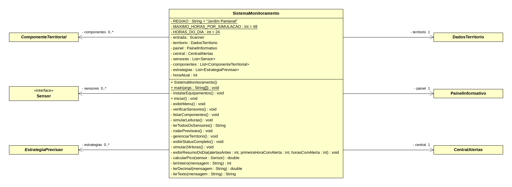

</details>

---

## Reflexão crítica

**Quando o sistema deve se calar?**
Com poucas leituras, qualquer previsão é um chute. Por isso a Média Móvel exige pelo menos 5 leituras e a Comparação exige 6. Abaixo disso, o sistema mostra *"o sistema se cala: ainda não há dados suficientes"* em vez de inventar um número. Ele também se cala quando o sensor está desligado ou falhou na última leitura, porque um alerta baseado em dado ruim é pior do que nenhum alerta. Mesmo com dados suficientes, nem sempre dá para confiar: numa das nossas execuções, para a mesma chuva, a Média Móvel previu 178% do limite (CRÍTICO) e a Comparação previu 76% (normal). Quando as estratégias discordam assim, o sistema avisa que a confiança é menor.

**O que os dados não representam?**
Um pluviômetro, uma régua e um sensor de umidade para um bairro inteiro dizem pouco sobre uma rua específica: a rua mais baixa pode alagar antes de o córrego chegar ao limite. Os dados também não mostram bueiros entupidos, lixo no córrego ou a chuva que cai rio acima, em outro bairro. Além disso, as duas estratégias trabalham com médias, e médias escondem picos. Num dos nossos testes, houve temporais de 63,6 e 51,2 mm/h em horas isoladas, e mesmo assim nenhum alerta de chuva saiu, porque esses picos se diluíram entre horas de chuva fraca. Em outra execução, a chuva chegou a 37,4 mm/h (acima do limite de 30), mas a Média Móvel previu cerca de 17 mm/h e nenhum alerta foi emitido. Por isso a verificação de sensores mostra a leitura atual como "ACIMA DO LIMITE", separada da previsão: o alerta não saiu, mas a informação continua visível para quem decide. O sistema é bom para **tendências** (como o rio subindo devagar ao longo do dia), mas pode deixar passar uma pancada de chuva súbita. Por fim, os valores são simulados com `Math.random()`. Eles têm faixas realistas, mas não são medições de verdade.

**Por que o alerta apoia a decisão, em vez de decidir por ela?**
Quem mora no território sabe coisas que o sistema não sabe: se a casa é térrea ou tem andar de cima, se há idosos ou crianças, se a rua já alagou antes com menos chuva. Por isso o alerta **explica** o motivo (sensor, valor previsto, limite e confiança) e **recomenda** uma ação, mas não manda ninguém sair de casa. Os limites também são uma decisão humana: quem os ajusta é a Defesa Civil, com o código de acesso, conforme a realidade do bairro.

**Limitação que percebemos nos testes: fadiga de alerta.**
Na simulação de 24 horas, o mesmo alerta se repete hora após hora (uma execução gerou 38 alertas em um dia). Na vida real, as pessoas param de prestar atenção num aviso que nunca muda.

---

## O que faltou e como continuaríamos

- **Avisar só quando o nível muda** (ex.: de ATENÇÃO para ALERTA), para evitar a fadiga de alerta.
- **Detectar picos isolados**, por exemplo com um alerta imediato quando uma única leitura passar muito do limite, sem esperar a média.
- **Combinar sensores:** chuva forte + solo encharcado + rio subindo ao mesmo tempo deveria pesar mais do que cada um sozinho.
- **Usar dados reais** de fonte pública (ex.: INMET, CGE) como base da simulação.
- **Salvar o histórico** em arquivo para não perder as leituras ao fechar o sistema.

---

## Divisão de tarefas

| Integrante | Responsabilidades |
|---|---|
| Nícolas Borges Natal | Desenvolvimento e testes no Eclipse, diagramas no Astah e versionamento no GitHub |
| Pedro Ricardo de Almeida | Revisão do projeto e sugestões de melhoria |
| Sofia Fernandes de Lima Oliveira | Revisão do projeto e sugestões de melhoria |

---

## Uso de IA

Usamos o **Claude** (assistente de IA da Anthropic) **somente como ferramenta de revisão**, no final do desenvolvimento. Não usamos a IA para escrever o código, desenhar os diagramas ou versionar o projeto.

**Onde usamos:**
- **Revisão final:** pedimos à IA para conferir o projeto contra cada critério do enunciado, para ver se não tínhamos perdido ou deixado passar algum ponto pedido na atividade. Ela apontou 4 ajustes, que testamos e aplicamos:
  - o rio e a umidade só subiam, e depois de um dia de simulação o sistema ficava travado em CRÍTICO;
  - o painel mostrava o último alerta avaliado, não o mais grave;
  - os métodos `ultrapassouLimite()` e `descreverTendencia()` existiam mas não eram usados (o segundo virou o `explicar()`);
  - um sensor desligado aparecia como "ACIMA DO LIMITE" por causa de uma leitura antiga.

**Como revisamos:**
- **Testamos cada etapa antes do commit:** compilamos e rodamos no Eclipse e comparamos a saída com o comportamento esperado.
- **Conferimos as contas na mão.** Exemplo: as últimas 5 leituras 15,7 + 25,5 + 7,7 + 36,0 + 9,7 = 94,6, e 94,6 ÷ 5 = 18,92, que bate com o valor da Média Móvel.
- **Conferimos as classificações** de ATENÇÃO, ALERTA e CRÍTICO contra as faixas da tabela.
- **Testamos o menu com entradas inválidas:** texto no lugar de número, código errado, população negativa e sensor desligado.
- **Depois dos ajustes da revisão, rodamos um roteiro de testes completo:** forçamos limites baixos para conferir que o painel mostra o alerta mais grave, desligamos e religamos sensores e rodamos a simulação de 24 horas três vezes seguidas para confirmar que o rio sobe e desce.
- **Os casos usados na reflexão crítica vieram das nossas próprias execuções:** os temporais que não geraram alerta, as estratégias que discordaram e os 38 alertas em 24 horas.